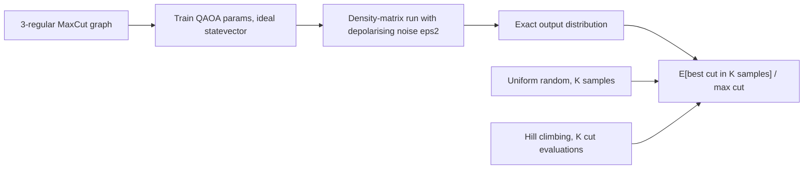
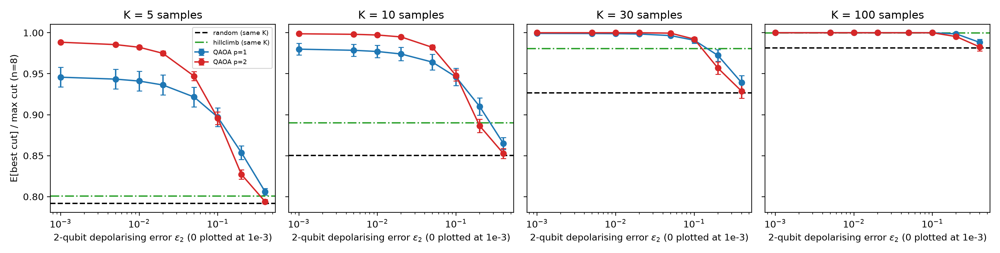
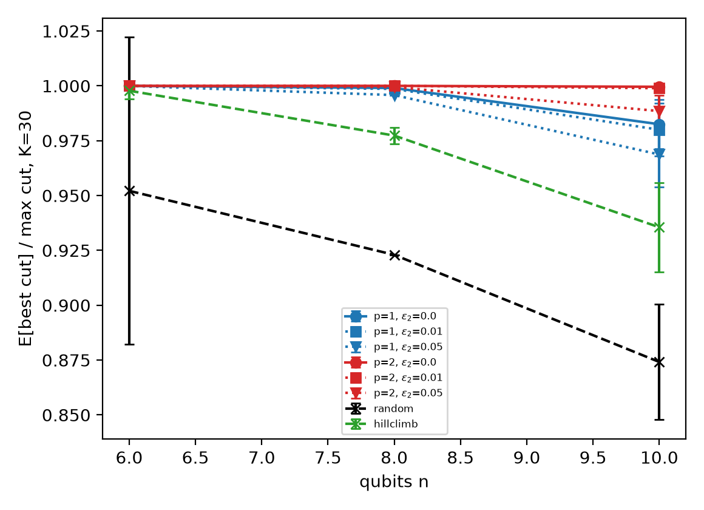

# QAOA best-of-K sampling under gate noise


**Abstract.** QAOA is usually scored by its expected cut, but an optimiser keeps the best of K samples. Using exact density-matrix simulation of MaxCut on random 3-regular graphs (n = 6-10) with depolarising gate noise, I compare the best-of-K cut of noiseless-trained QAOA (p = 1, 2) with uniform random sampling and with a classical hill climber given the same number of cut evaluations. In this simulated setting QAOA stays above random sampling at every noise level tested (up to eps2 = 0.4), and the point where the second QAOA layer stops helping lies at lower noise for the mean cut than for best-of-K.

## Motivation and research gap
Reviews of QAOA stress error susceptibility and noise resilience (Blekos et al., 2024, doi:10.1016/j.physrep.2024.03.002), noise is the main obstacle before fault tolerance (Kim et al., 2023, doi:10.1038/s41586-023-06096-3), and mitigation still has open problems (Cai et al., 2023, doi:10.1103/RevModPhys.95.045005). Small Qiskit MaxCut studies are noiseless and tiny (Al Salti & Asif, 2027, doi:10.1007/978-3-032-32862-5_1). What is rarely quantified is how the *best-of-K* outcome, the quantity a solver uses, degrades with gate noise against equal-budget classical baselines. See `docs/RESEARCH_GAP.md` and `docs/METHOD.md`.

## Method

Parameters are trained without noise and deployed with noise (eps2 after each RZZ, eps2/10 after each RX). Because the output distribution is exact, best-of-K is computed in closed form, so the curves contain no shot noise; only variation across graphs is shown. 5 graphs for the main sweep (n = 8), 3 for scaling.

## Results
Numbers below are from `results/summary_qaoa.csv`, `summary_baselines.csv`, `summary_success.csv`, `scaling.csv`.

E[best cut]/max cut, n = 8, mean over 5 graphs (std across graphs in the CSVs; K=5 std ≤ 0.01 at eps2 ≤ 0.1):

| Method | K=5 | K=10 | K=30 | K=100 |
|---|---|---|---|---|
| Uniform random | 0.792 | 0.850 | 0.927 | 0.981 |
| Hill climbing (K evaluations) | 0.801 | 0.890 | 0.981 | 1.000 |
| QAOA p=1, eps2=0 | 0.946 | 0.980 | 0.999 | 1.000 |
| QAOA p=1, eps2=0.05 | 0.922 | 0.964 | 0.997 | 1.000 |
| QAOA p=1, eps2=0.4 | 0.806 | 0.865 | 0.939 | 0.988 |
| QAOA p=2, eps2=0 | 0.988 | 0.999 | 1.000 | 1.000 |
| QAOA p=2, eps2=0.05 | 0.947 | 0.982 | 1.000 | 1.000 |
| QAOA p=2, eps2=0.4 | 0.794 | 0.853 | 0.929 | 0.983 |



Mean cut ratio (K=0 rows): p=1 falls from 0.804 (eps2=0) to 0.718 (0.1); p=2 from 0.882 to 0.702. p=2 beats p=1 at eps2=0.05 (0.772 vs 0.756) and loses at 0.1. For best-of-K=5 the two depths are level at eps2=0.1 (0.896 vs 0.897) and p=1 wins from 0.2 (0.854 vs 0.827); probability of at least one optimum in K=5 is 0.352 (p=2) vs 0.341 (p=1) at 0.1 and 0.147 vs 0.204 at 0.2. Random sampling finds an optimum within 5 samples with probability 0.083; ideal p=2 QAOA with 0.888.

Scaling (K=30, `scaling.csv`, 3 graphs): at n=10 random 0.874, hill climbing 0.936, QAOA p=1 0.983 (eps2=0), 0.969 (0.05), p=2 1.000 (0), 0.989 (0.05).



## Discussion
- **H1 supported in simulation:** QAOA best-of-K stays above random sampling for all tested eps2, including 0.4 for p=1 (K=5: 0.806 vs 0.792, i.e. almost at the floor). The margin shrinks quickly: at eps2=0.4 it is ~0.01 in ratio.
- **H2 weakly supported:** the mean cut favours p=1 already at eps2=0.1, while best-of-K needs eps2 of about 0.1-0.2 before the p=1/p=2 order flips. Differences near the crossing are below 0.003 in ratio, so the exact location is only resolved to the grid {0.05, 0.1, 0.2}.
- **Classical comparison is not one-sided:** with equal evaluation budgets a trivial hill climber is as good as QAOA at K=100 and beats it at K≥30 only when QAOA is heavily noisy; at small K QAOA is ahead. But the sample counts are not equivalent costs (a QPU shot vs a classical cut evaluation), and n ≤ 10 is brute-forceable, so this is no evidence of quantum advantage.
- Negative/neutral: K=100 saturates at n=8 (256 bitstrings), so large K is uninformative at this size.

## Limitations
Depolarising noise only (no readout error, crosstalk, coherent errors); no transpilation or connectivity constraints; the cost layer is applied as one block before the per-edge channels; parameters are not re-trained under noise; no error mitigation; tiny instances; graph seeds 0-2 give identical n=8 cut statistics (std 0.000 in scaling), so scaling error bars understate variability.

## Future work
Run on hardware with transpiled circuits, add readout error and mitigation (e.g. ZNE, as in related work below), noise-aware retraining, CVaR objectives, larger n with tensor-network or circuit-cutting simulation, and a comparison against stronger classical solvers (MILP, Goemans-Williamson) at matched wall-clock.

## Reproducibility
```
pip install -r requirements.txt
python -m pytest -q
python experiments/run_all.py --quick   # ~10 s
python experiments/run_all.py           # ~2 min
```
Full run: 120 s on Windows 11, Python 3.11.9, 16-thread CPU (numpy only, no GPU). Library versions used: numpy 2.2.6, scipy 1.17.1, pandas 2.3.3, matplotlib 3.11.1, networkx 3.6.1.

## Structure
`src/qaoa_bok/` (qaoa.py: simulators, best-of-K, hill climbing; study.py: sweeps), `experiments/run_all.py`, `tests/`, `docs/`, `results/`, `figures/`.

## Related work by the author
- [xy-mixer-vs-penalty-qaoa-noise-crossover](https://github.com/pradeepdegalaroyal/xy-mixer-vs-penalty-qaoa-noise-crossover)
- [modular-chip-aware-qaoa-placement](https://github.com/pradeepdegalaroyal/modular-chip-aware-qaoa-placement)

## Citation

If you use this code, please cite it (see also `CITATION.cff`):

```bibtex
@software{chenchupradeep2026qaoabestofks,
  author  = {Chenchupradeep, Degala},
  title   = {QAOA best-of-K sampling under gate noise},
  year    = {2026},
  version = {0.1.0},
  url     = {https://github.com/pradeepdegalaroyal/qaoa-best-of-k-sampling-noise},
  license = {MIT}
}
```

MIT license (`LICENSE`).
